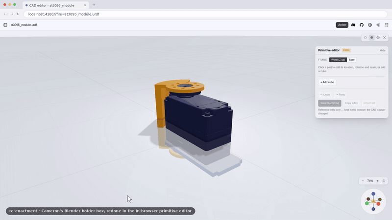
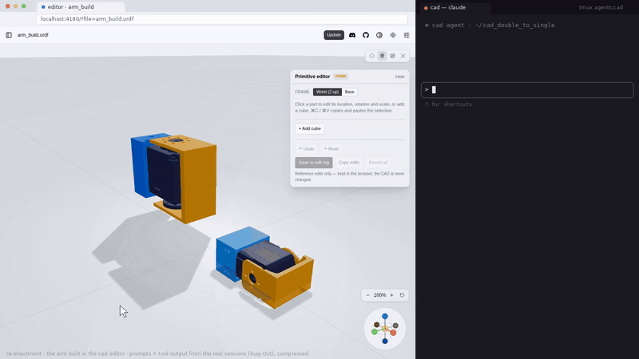

# claude-as-cad

A browser viewer and editor for robot CAD, built to work alongside Claude Code.

You point at things in 3D; Claude writes the CAD. Click a surface and Claude gets its exact
coordinates. Block out a change by moving parts or dropping in boxes right in the browser. Then
watch the model reload as Claude rewrites the files. The browser never edits your CAD — every
edit is a reference that your agent turns into real geometry.

claude-as-cad is a fork of the CAD Viewer from
[earthtojake/text-to-cad](https://github.com/earthtojake/text-to-cad) (MIT), with a reference
editor, an edit log, and click-to-reference added for agent-driven robot design.

## The three ingredients

### 1. Click to reference

Click any surface. The viewer copies a tag like

```
[holder.stl in link_5 @ (76.0, 107.2, 48.3)mm | local (12.3, -4.5, 8.1)mm n(0.00, 0.00, -1.00) tri 1423, -X side face]
```

with the point in the robot's base frame, the same point in the STL's own frame, the face normal,
and the triangle index. Paste it into Claude Code instead of describing "the face on the left
side of the holder."


<sub>Re-enactment of a real session (viewer re-rendered for the clip).</sub>

### 2. Block it out in the browser

Select a part and drag its location, rotation, and scale fields left or right, Blender-style.
Add named boxes with per-axis size as placeholders for parts that don't exist yet, delete parts
from the view, and ⌘C / ⌘V to duplicate parts or boxes. Edits follow the robot's joints.



<sub>Recorded in the actual editor (scripted replay of a real edit).</sub>

### 3. Watch Claude build it

When Claude rewrites the model file you have open, the viewer reloads it automatically and
keeps your camera where it was. Your browser edits become a log Claude can read
and realize as real geometry in your generator scripts.



<sub>Staged replay of a real build session, run in the actual editor.</sub>

## Quick start

Requires Node.js 20+.

```bash
git clone https://github.com/cameronosmith/claude-as-cad.git
cd claude-as-cad
npm install
npm run build
npm run serve -- --dir /path/to/your/cad --port 4178
```

Open `http://127.0.0.1:4178/?file=robots/my_robot.urdf` (`file` is relative to `--dir`). The
sidebar lists every CAD file under `--dir`. The server binds to `127.0.0.1` by default.

Supported files (from the upstream viewer): `.urdf`, `.sdf`, `.srdf`, `.step`/`.stp`, `.stl`,
`.3mf`, `.glb`, `.dxf`, `.gcode`. The editor panel appears for URDF robots.

## Using the editor

| Action | How |
| --- | --- |
| Select a part | Click it (this also copies its reference tag) |
| Change a value | Drag the field left/right · Shift = fine · ⌘/Ctrl = snap · click to type |
| Add a box | **+ Add cube** (40 mm, at the center of the scene) |
| Duplicate | ⌘C / ⌘V (names count up: `cube2`, `holder_2`, …) |
| Remove a part from the view | **Delete part** (restore from the edits list) |
| Undo / redo | ⌘Z / ⇧⌘Z |
| Frame | **World (Z-up)** like Blender, or **Base** to match click-to-reference coordinates |

Rotation and scale pivot on each part's geometry center. Values are in mm and degrees.

## Edits are references, not CAD changes

Nothing you do in the editor is written into your CAD files. Edits live as a draft in your
browser (per model, survives reloads). **Save to edit log** appends a record for your agent:

- `EDIT_LOG.md` — a readable index, newest at the bottom
- `<model>__<timestamp>.json` — exact transforms for every edit

Records are written to `CAD_EDITOR_EDITS_DIR` (default `~/cad_editor_edits`). **Copy edits**
puts the same summary on your clipboard, e.g.

```
MOVE holder.stl (link_4): center (326.6, -0.3, 335.4)mm -> (326.6, -0.3, 385.4)mm | rot (0.0, 0.0, 0.0)deg | scale (1.000, 1.000, 1.000)
CUBE "cube1" (world): center (139.0, 0.6, 284.8)mm | rot (0.0, 0.0, 0.0)deg | size 40.0 x 40.0 x 40.0mm
```

The record format (`stl_delta`, `link_local`, `copies`) is documented in
[docs/edit-log.md](docs/edit-log.md).

By default the edit-log endpoint only accepts requests from the same machine. Set
`CAD_EDITOR_LOG_ALLOW_REMOTE=1` to accept them from other hosts on a network you trust.

## Status

Early (v0.1). claude-as-cad is based on a snapshot of the upstream CAD Viewer (v0.3.8);
upstream has moved on since. The editor is in active use on a real robot-arm project, but expect
rough edges, and file issues when you hit them.

## Credits

- **CAD Viewer** by Thompson Labs LLC, from [earthtojake/text-to-cad](https://github.com/earthtojake/text-to-cad) (MIT) — the viewer, file formats, and app shell this project is built on. For the agent side, see their [agent skills](https://github.com/earthtojake/text-to-cad).
- [three.js](https://threejs.org/) for rendering.
- The reference editor, edit log, and click-to-reference were built by Cameron Smith, developed together with Claude Code agents.

The upstream viewer's detailed configuration and runtime docs are kept in
[docs/viewer.md](docs/viewer.md).

## License

MIT — see [LICENSE](LICENSE). Upstream portions remain © Thompson Labs LLC under the same license.
