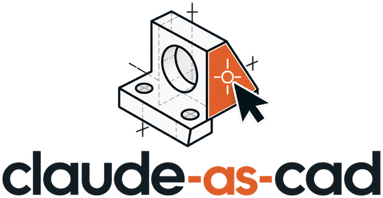
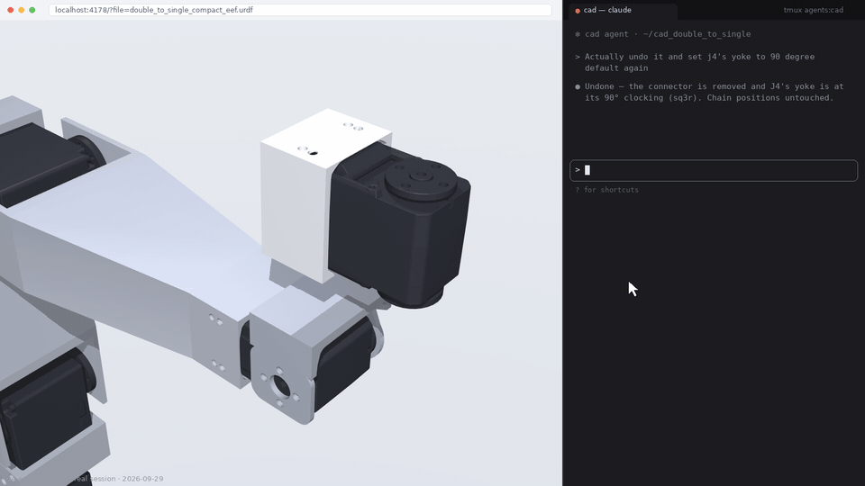
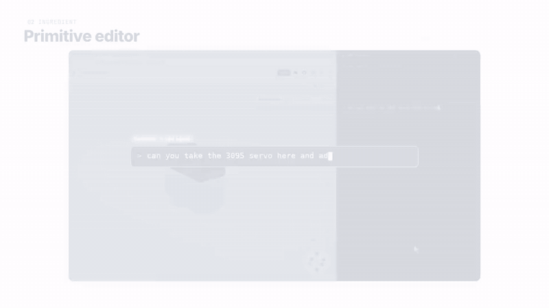
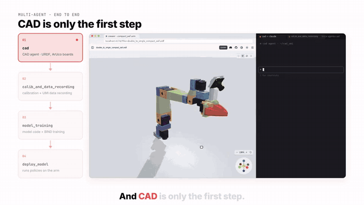
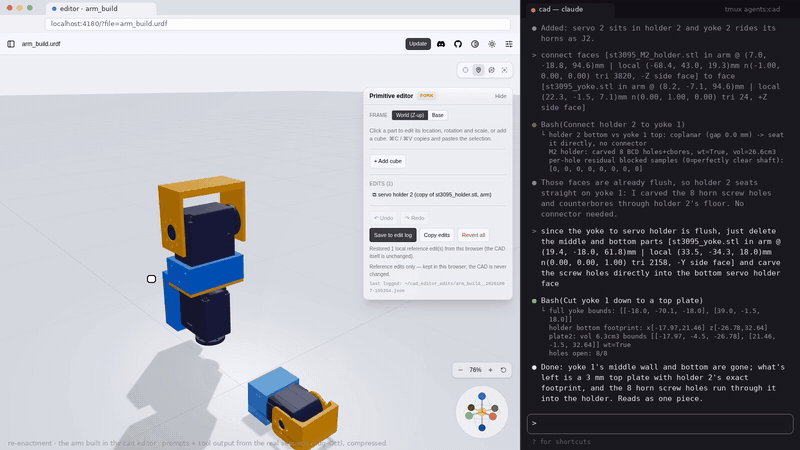

<p align="center">
  
</p>

<p align="center"><b>A claude-native CAD software for actually building things with coding-CAD agents.</b></p>

<p align="center">
  <a href="http://omidlab.net/claude-as-cad/">Interactive demos</a> ·
  <a href="#quick-start">Quick start</a> ·
  <a href="#using-the-editor">Using the editor</a>
</p>

---

claude-as-cad is a Claude-native\* CAD software built to augment standard code-CAD prompting — featuring
click-to-reference sub-part targeting, a 3D primitive editor, and hierarchical note records.

It's super simple and enables more effective CAD prompting and editing by augmenting your coding-CAD agent's
3D viewer with just a few features:

1. [**Click to reference**](#1-click-to-reference)
2. [**3D primitive editor**](#2-3d-primitive-editor)
3. [**Hierarchical notes**](#3-hierarchical-notes)

<sub>\* I refer to everything as claude-based because it sounds nice, but any coding agent is applicable.</sub>

> **The main failure mode of using text-based prompting for code-CAD agents is ambiguity in coordinates** —
> explaining where to place an object, or even identifying which part you mean, via text is imprecise and
> error-prone.

Plain-text CAD-prompting fails because it doesn't support sub-part pointing, visual sketching, or long-term
organized memory and rules across builds. claude-as-cad fixes this with click-to-reference spatial pointing, a
3D primitive editor, and hierarchical build notes that survive chat compactifications. These ingredients
transform coding agents from a chat interface closer to a claude-centric CAD software suite.

claude-as-cad is a fork of the CAD Viewer from [earthtojake/text-to-cad](https://github.com/earthtojake/text-to-cad)
(MIT).

## The three ingredients

### 1. Click to reference

Click any object and its 3D point, mesh face, and object ID are copied to your clipboard, so you can paste them
straight into the chat — instead of describing *the face on the left side of the holder*.

```
[holder.stl in link_5 @ (76.0, 107.2, 48.3)mm | local (12.3, -4.5, 8.1)mm n(0.00, 0.00, -1.00) tri 1423, -X side face]
```

- The point in the robot's base frame, in mm
- The same point in the STL's own frame, plus the mesh face and object ID



<sub>From the Claude-as-CAD video. The session shown is a re-enactment of a real one.</sub>

### 2. 3D primitive editor

Manually move, rotate, delete, or duplicate any existing object, or drop in a new cube primitive to show Claude
exactly where things go when words are too imprecise. Edits are approximate references for Claude, not intended
to be exact CAD edits.

- Drag fields left/right like Blender — <kbd>Shift</kbd> for fine, <kbd>⌘</kbd> to snap, click to type
- Add boxes, delete parts from the view, <kbd>⌘C</kbd> / <kbd>⌘V</kbd> to duplicate
- <kbd>⌘Z</kbd> undo, and edits follow the robot's joints
- **Save to edit log** writes a summary and exact transforms for Claude to read



<sub>From the Claude-as-CAD video. Re-enactment in the actual editor; the Claude Code side is replayed from a real session.</sub>

### 3. Hierarchical notes

Claude gives each CAD object its own folder, next to notes on servo motor properties, ArUco generator scripts,
pitfalls, and everything learned so far — so Claude starts every task already knowing what you've figured out in
past builds. Especially after a long session is compacted, Claude can point itself back at them.

```
cad/
  docs/
    arm/  camera_mount/  gantry/
    servos.md        # motor dimensions, horn offsets
    aruco_robot.md   # marker generators
    pitfalls.md      # read before generating anything
    DESIGN_INDEX.md
  cadlib/
    aruco.py  beautify.py
```


<sub>From the Claude-as-CAD video.</sub>

## Multi-agent: across the whole robotics stack

One motivation of using Claude as your CAD agent is that the same agent that designs your robot can communicate to
the downstream parts of the robotics stack, e.g. for data collection, training, and inference agents.

**CAD → calibration & data recording → training → inference**

After building the handheld UMI gripper design, the CAD agent added ArUco markers, sent the sheet to print, and
handed the model to a calibration and data-recording agent. That agent launched the recording script where I
recorded 50 demos; a training agent trained a policy on the new dataset using my BIND project code, and a robot
inference agent ran it on the real arm.



<sub>From the Claude-as-CAD video (1.5× speed). Real recordings, sped up in places; agent chat panes partly recomposed for the edit.</sub>

## Putting it together: a whole arm

Place each servo module in the editor, duplicate and reposition for new joints, click the faces to connect, and
Claude builds the connector links. Your browser edits become a log Claude reads and you can reference to integrate
into your build.



<sub>2× speed. Staged replay of a real build session, run in the actual editor.</sub>

## Quick start

**Just point your agent here.**

Requires Node.js 20+. Point `--dir` at the folder that holds your URDFs and meshes.

```bash
git clone https://github.com/cameronosmith/claude-as-cad.git
cd claude-as-cad
npm install
npm run build
npm run serve -- --dir /path/to/your/cad --port 4178
```

Then open `http://127.0.0.1:4178/?file=robots/my_robot.urdf` (`file` is relative to `--dir`). The sidebar lists
every CAD file under `--dir`. The server binds to `127.0.0.1` by default.

Supported files (from the upstream viewer): `.urdf`, `.sdf`, `.srdf`, `.step`/`.stp`, `.stl`, `.3mf`, `.glb`,
`.dxf`, `.gcode`. The editor panel appears for URDF robots.

## Using the editor

| Action | How |
| --- | --- |
| Select a part | Click it (this also copies its reference tag) |
| Change a value | Drag the field left/right · <kbd>Shift</kbd> = fine · <kbd>⌘</kbd>/<kbd>Ctrl</kbd> = snap · click to type |
| Add a box | **+ Add cube** (40 mm, at the center of the scene) |
| Duplicate | <kbd>⌘C</kbd> / <kbd>⌘V</kbd> (names count up: `cube2`, `holder_2`, …) |
| Remove a part from the view | **Delete part** (restore from the edits list) |
| Undo / redo | <kbd>⌘Z</kbd> / <kbd>⇧⌘Z</kbd> |
| Frame | **World (Z-up)** like Blender, or **Base** to match click-to-reference coordinates |

Rotation and scale pivot on each part's geometry center. Values are in mm and degrees.

### Edits are references, not CAD changes

Nothing you do in the editor is written into your CAD files. Edits live as a draft in your browser (per model,
survives reloads). **Save to edit log** appends a record for your agent:

- `EDIT_LOG.md` — a readable index, newest at the bottom
- `<model>__<timestamp>.json` — exact transforms for every edit

Records are written to `CAD_EDITOR_EDITS_DIR` (default `~/cad_editor_edits`). **Copy edits** puts the same summary
on your clipboard, e.g.

```
MOVE holder.stl (link_4): center (326.6, -0.3, 335.4)mm -> (326.6, -0.3, 385.4)mm | rot (0.0, 0.0, 0.0)deg | scale (1.000, 1.000, 1.000)
CUBE "cube1" (world): center (139.0, 0.6, 284.8)mm | rot (0.0, 0.0, 0.0)deg | size 40.0 x 40.0 x 40.0mm
```

The record format (`stl_delta`, `link_local`, `copies`) is documented in [docs/edit-log.md](docs/edit-log.md).

By default the edit-log endpoint only accepts requests from the same machine. Set `CAD_EDITOR_LOG_ALLOW_REMOTE=1`
to accept them from other hosts on a network you trust.

## Status

Early (v0.1). claude-as-cad is based on a snapshot of the upstream CAD Viewer (v0.3.8); upstream has moved on
since. The editor is in active use on a real robot-arm project, but expect rough edges, and file issues when you
hit them.

## Credits

- **CAD Viewer** by Thompson Labs LLC, from [earthtojake/text-to-cad](https://github.com/earthtojake/text-to-cad) (MIT) — the viewer, file formats, and app shell this project is built on.
- [three.js](https://threejs.org/) for rendering.
- The reference editor, edit log, and click-to-reference were built by Cameron Smith, developed together with Claude Code agents.

The upstream viewer's detailed configuration and runtime docs are kept in [docs/viewer.md](docs/viewer.md).

## License

MIT — see [LICENSE](LICENSE). Upstream portions remain © Thompson Labs LLC under the same license.
